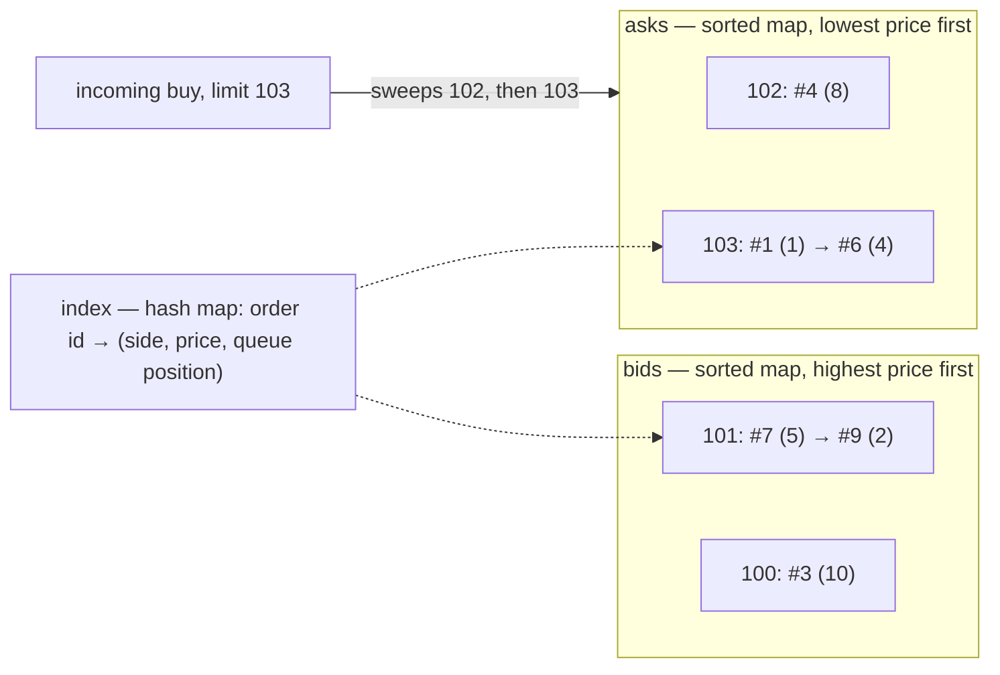

# limit-order-book

A price-time-priority limit order book and matching engine in C++20. It supports limit, market,
IOC and FOK orders, cancels, in-place size reductions and cancel/replace. It is tested by
replaying random order flow against a deliberately naive reference book.

## Design



Each side is a `std::map` from integer price (ticks) to a FIFO queue of orders. A hash map from
order id to the order's queue iterator makes cancels O(1) once the level is found.

| operation | cost |
|---|---|
| best bid / ask | O(1) |
| add at a new price level | O(log L), where L = number of levels |
| cancel, reduce | O(1) + level lookup |
| each fill | O(1) |

Prices are integer ticks, so there are no floating-point price comparisons.

## Semantics

- **Price-time priority.** Better prices trade first. Within a price, earlier orders trade first.
- **Trades happen at the resting order's price.** An aggressive buyer at 105 against an ask at 100 pays 100.
- **Time in force.** `GTC` rests any remainder, `IOC` cancels it, and `FOK` trades in full or not at all.
  Market orders never rest.
- **`reduce(id, q)`** lowers the size in place and keeps the order's queue position.
  **`replace(id, p, q)`** is a cancel plus a new order, so it goes to the back of the queue. This
  matches common exchange rules: increasing size or changing price loses priority.
- An order with a non-positive size, or with an id that is already live, is rejected.

## Verification

- **Differential testing.** `tests/reference_book.hpp` is a naive book: one flat vector and
  linear scans, sharing no code with the real one. The test sends 30,000 random operations
  (limits, IOC/FOK, markets, cancels, reduces, replaces, duplicate ids) to both books. After every
  operation it requires identical results, trades and full depth on both sides, and checks that
  the book is never left crossed.
- **Unit tests** cover each rule above: price and time priority, sweeping, IOC/FOK, and reduce vs replace.
- **CI** runs the suite in Release and again under AddressSanitizer + UndefinedBehaviorSanitizer.

## Benchmark

`lob_bench` replays 2 million synthetic operations: 70 % limit orders within 20 ticks of a drifting
mid, 25 % cancels and 5 % market orders. Results on a 2-vCPU cloud VM with GCC 13 and `-O3`:

| metric | value |
|---|---|
| throughput | 6.4 M ops/s |
| latency p50 / p90 / p99 / p99.9 | 138 / 322 / 731 / 1,217 ns |

The latency figures include about 20 ns of clock overhead per sample. The worst-case tail is
dominated by allocator and page-fault noise, which is the obvious next optimisation target (see
below).

## Usage

```cpp
#include "lob/order_book.hpp"
using namespace lob;

OrderBook book;
book.submit_limit(1, Side::Sell, 10'050, 300);
book.submit_limit(2, Side::Sell, 10'060, 200);
Result r = book.submit_limit(3, Side::Buy, 10'060, 400, TimeInForce::IOC);
// r.filled == 400: 300 @ 10'050, then 100 @ 10'060
for (const Trade& t : r.trades) { /* t.resting_id, t.price, t.qty */ }
```

## Build

```bash
cmake -S . -B build -DCMAKE_BUILD_TYPE=Release
cmake --build build -j
ctest --test-dir build --output-on-failure
./build/lob_bench 2000000
```

## Next steps

- Replace `std::list` nodes with an intrusive list over a pooled slab. This removes the
  per-order heap allocation, which drives the latency tail.
- For instruments with a bounded tick range, use a flat price ladder (array indexed by tick) instead of
  `std::map`, giving O(1) level access.
- Publish market-data updates (L2 deltas) through a lock-free queue to a separate thread.

## License

Copyright (c) 2026 Ankit Pawar. All Rights Reserved.

This repository is public so that the work can be read and evaluated, but it is not open source. Using, copying, modifying, redistributing or commercially exploiting any part of it requires prior written permission. This does not affect what applicable law allows without permission, or viewing and forking the repository on GitHub under GitHub's Terms of Service. The full terms are in [LICENSE](LICENSE).

Commits up to and including `6aa446d` were released under the MIT License, and copies obtained under those terms keep them.

For licensing or collaboration, email ankitpawar0007x@gmail.com or visit [ankitinorbit.com](https://ankitinorbit.com).
